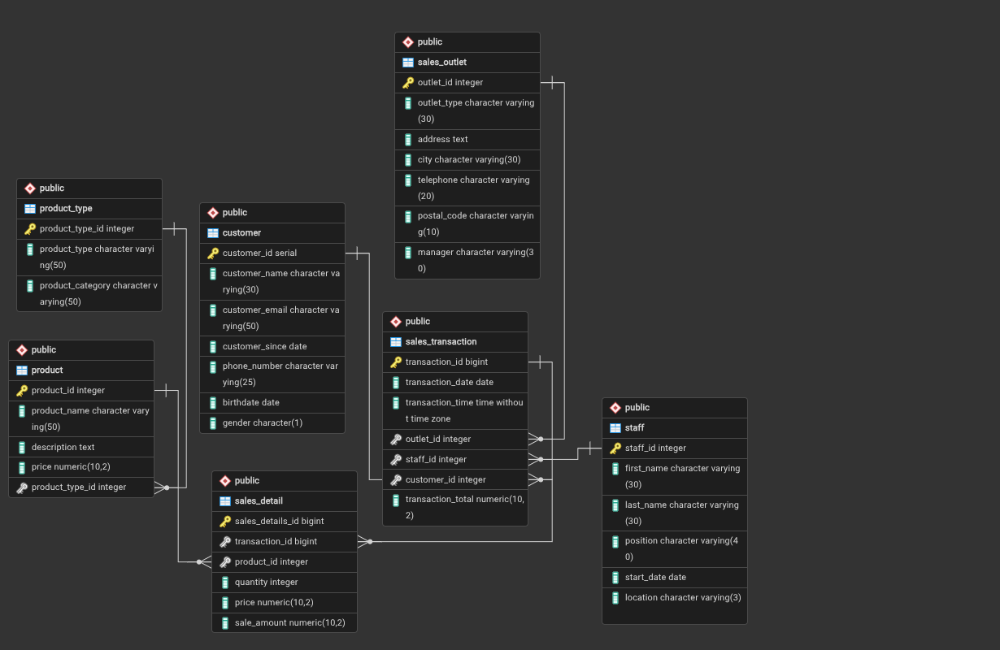

# Retail Sales Database

## Overview

A PostgreSQL retail sales database designed using pgAdmin ERD Tool.

## Database Schema

The database contains:

- Customers
- Products
- Product Types
- Outlets
- Staff
- Sales Transactions
- Sales Details

## Relationships

- One outlet can have many staff members.
- One customer can have many sales transactions.
- One transaction can contain many products.
- One product belongs to one product type.

## Technologies

- PostgreSQL
- pgAdmin 4
- SQL

## Files

- schema/create_tables.sql
- data/sample_data.sql
- ERD/coffee_shop_ERD-v2.pgerd.png
- SQL_practice (SQL scripts to put into practice my skills)


## Structure

```text
├── data
│   ├── sample_data_backup.sql
│   └── sample_data.sql
├── ERD
│   ├── coffee_shop_ERD-v2.pgerd
│   └── coffee_shop_ERD-v2.pgerd.png
├── README.md
├── schema
│   ├── create_tables.sql
│   └── modifying_database.sql
└── SQL_practice
    ├── indexes
    │   ├── 0_initial_index_strategy.sql
    │   ├── 1_index_usage.sql
    │   ├── 2_0_missing_Indexes.sql
    │   ├── 2_1_missing_Indexes.sql
    │   ├── 3_Detect_duplicates.sql
    │   ├── 4_update_statistics.sql
    │   ├── 5_index_bloat.sql
    │   ├── 6_0_analyze_query.sql
    │   ├── 6_1_analyze_query.sql
    │   ├── 6_2_analyze_query.sql
    │   ├── 6_3_analyze_query.sql
    │   ├── 7_autovacuum.sql
    │   ├── index_strategy
    │   │   ├── 1000308956.jpg
    │   │   ├── IndexMaintenanceSchedule.md
    │   │   ├── index _strategy.md
    │   │   └── other_index_strategies.md
    │   ├── scenario_1
    │   │   ├── query_execution_plan_after.csv
    │   │   ├── query_execution_plan_before.csv
    │   │   ├── query_execution_plan_final.csv
    │   │   └── Query optimization.md
    │   └── scenario_2
    │       ├── query_execution_plan_modified_after.csv
    │       ├── query_execution_plan_modified.csv
    │       ├── query_execution_plan_original_after.csv
    │       ├── query_execution_plan_original.csv
    │       └── Query optimization.md
    ├── queries
    │   ├── beginner_to_advance.sql
    │   ├── CTEs.sql
    │   ├── null_handling.sql
    │   ├── subqueries.sql
    │   └── window_functions.sql
    └── sql_programing
        └── ACID_transactions.sql

```
## ERD

