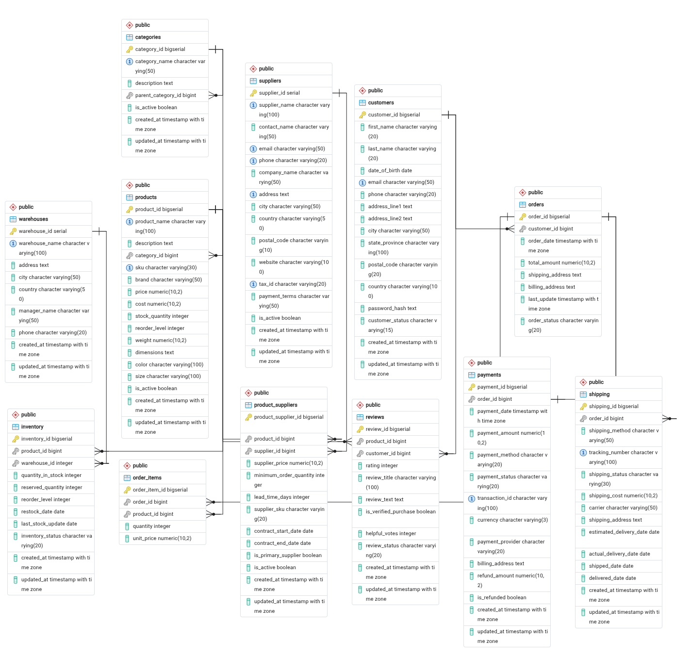

# E-Commerce OLTP Database System

## Overview

This project demonstrates the design and implementation of an **Online Transaction Processing (OLTP)** database for an e-commerce application using SQL.

The database is normalized to support day-to-day business operations such as managing customers, products, orders, payments, and inventory while maintaining data integrity and minimizing redundancy.

This project showcases fundamental database design principles that are essential for Database Administrators (DBAs), Data Engineers, and Backend Developers.

---

# Project Structure

```text
.
├── ecommerce_db.sql
└── ERD_ecommerce_db.png
```

* **`ecommerce_db.sql`** – SQL script containing the database schema, including tables, constraints, indexes, and relationships.
* **`ERD_ecommerce_db.png`** – Entity Relationship Diagram (ERD) illustrating the database structure and relationships.

---

# Features

* Relational database design
* Normalized schema
* Primary and foreign key constraints
* Referential integrity
* Appropriate data types
* One-to-one, one-to-many, and many-to-many relationships (where applicable)
* Indexes for query performance
* Well-structured SQL schema

---

# Entity Relationship Diagram

The ERD provides a visual representation of the database structure.



---

# Database Design Goals

This database is designed to:

* Store customer information
* Manage products and categories
* Process customer orders
* Track order items
* Maintain inventory
* Record payments
* Enforce data integrity through constraints
* Support efficient transactional operations

---

# Technologies Used

* PostgreSQL (or your SQL database of choice)
* SQL
* Entity Relationship Modeling (ERD)

---

# Skills Demonstrated

* Relational Database Design
* Database Normalization
* SQL Data Definition Language (DDL)
* Primary Keys
* Foreign Keys
* Constraints
* Indexing
* Entity Relationship Modeling
* OLTP Database Design
* Schema Design Best Practices


# Learning Objectives

This project is intended to practice:

* Designing normalized relational databases
* Building production-style SQL schemas
* Creating relationships between tables
* Applying database constraints
* Understanding OLTP database architecture
* Reading and creating ER diagrams


---

# License

This project is provided for educational and portfolio purposes.
